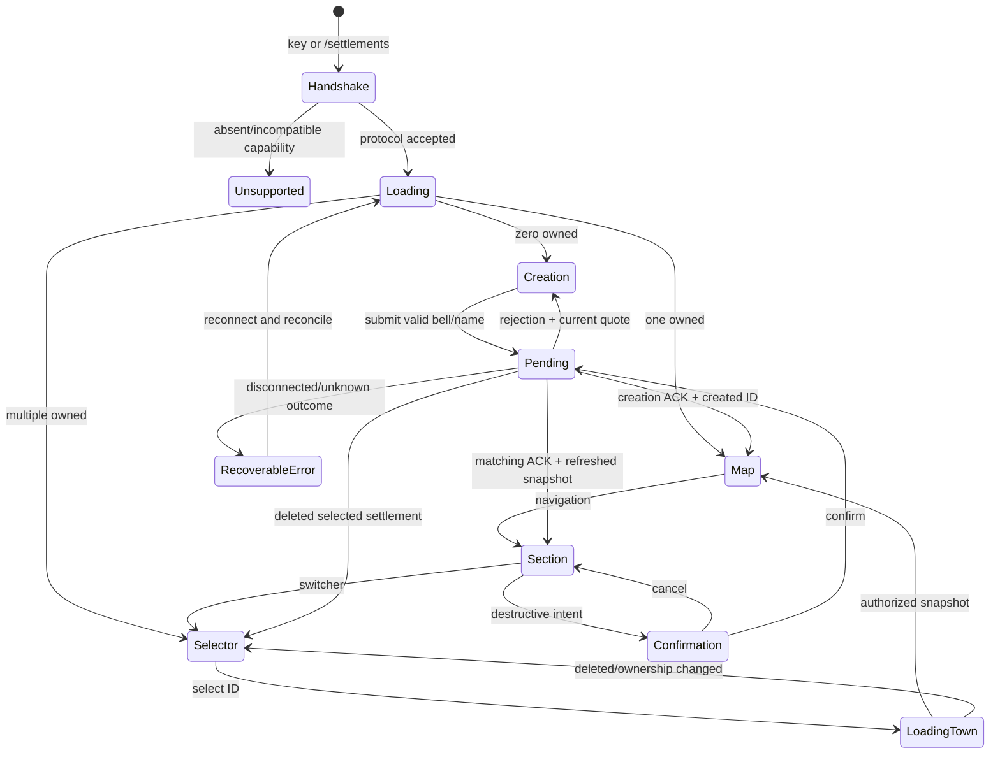

# GUI state and action contract

Status: proposed; protocol and classes below do not yet exist. Same client flow for integrated and dedicated logical servers. No client-local simulation of success.

## Entry and navigation

For multiple towns, opening always shows selector. Remembered ID only highlights a still-owned entry; it does not skip the selector. Zero owns opens Creation even without a valid looked-at bell: show the real missing-bell instruction and disable Create. Explicit post-create ACK opens its created town even if the owner now has several. After deletion clear remembered ID and return to selector, with Create empty state if needed.

Escape closes modal first, then detail -> parent section, then shell -> game. It must not auto-confirm or cancel an already sent financial mutation. A returned server result never reopens an intentionally closed screen. Guide returns to its exact caller.

## Session model

Connection session contains server-issued session token, world identity, supported capabilities, protocol version, pending operations and immutable server views. Selection contains town UUID and section, never list index. Disconnect/world unload clears views, food policy, selection and pending UI state; no data crosses worlds/servers. Per-world remembered selection is advisory only and revalidated server-side.

Proposed wire envelopes:

- `HelloRequest(requestId, supportedProtocolRange)` is sessionless and bounded; its response supplies protocol, capabilities, server/world identity and server-issued session token. Only then send `OpenRequest(session, requestId)` for the paginated owner directory.
- `ViewRequest(session, townId, section, pageCursor, knownRevision)` -> scoped snapshot.
- `ActionRequest(session, requestId, townId, expectedRevision, action, boundedPayload)`.
- `ActionResult(session, requestId, townId, status, reasonKey, typedArguments, resultingRevision, receiptId?)`.
- `ViewDelta(session, townId, baseRevision, resultingRevision, changedFields)`; base mismatch requests a snapshot.

All envelopes need explicit byte/string/list limits before codec implementation. Directory/resident/stock pages must be bounded (proposal64 rows/page); unlimited settlements means pagination, never unlimited packet allocation. Coordinates are integers and money is checked positive long copper units. Client never supplies trusted prices, owner UUID, food effects or inventory quantities. No common packet type loads client or optional NPC classes.

Transport policy: the standalone settlement bootstrap channel accepts an absent remote endpoint so a Settlements client can join an otherwise compatible vanilla/Forge server and show Unsupported locally. Never send custom packets when `isRemotePresent` is false. A small stable bootstrap protocol negotiates the gameplay protocol before any town payload. Known incompatible bootstrap versions fail at connection with a localized compatibility reason; do not promise an in-game screen after Forge has rejected login. Supported bootstrap but incompatible gameplay protocol may join and show the read-only Unsupported screen. This replaces the existing strict town-channel acceptance policy. Optional-mod network channels and currency registry compatibility may impose additional connection requirements; standalone UI capability detection cannot bypass Forge registry handshakes.

## Transaction lifecycle

`EDITING -> QUOTED -> PENDING -> ACKNOWLEDGED | REJECTED | OUTCOME_UNKNOWN`.

Quote binds session/town/action/geometry/source accounts/revision. A stale quote is rejected with refreshed values; never charge a newly calculated price without renewed confirmation. One outstanding mutating operation per affected resource. While pending, disable conflicting controls with a localized explanation. Repeated click reuses the operation ID; it never creates a second payment request. Server persists intent parameters/hash, receipt and result; same ID/different payload rejects. Retention/expiry must leave an explicit reconciliation path; a bounded in-memory button lock is not financial idempotency.

The logical-server thread checks authenticated actor, town ownership, entity membership/aliveness, dimension, placement, loaded inventory/reach when needed, capabilities, revision and funds. Revalidate physical destination immediately before commit. Persist money/claim or inventory/delivery intent and recovery outcome coherently. After a timeout show “Результат уточняется” / “Checking result”; request status for the original ID. Do not automatically resend with a new ID or imply failure/refund.

Create, treasury transfer, expansion, payroll recovery and deletion must each define their crash-recovery mechanism before implementation is complete. Existing independent SavedData/container writes are not proof of cross-save atomicity.

## View refresh contract

| Event | Invalidated views | Authoritative owner |
| --- | --- | --- |
| Resident joins/leaves/dies | Directory count; residents; details; happiness | SettlementSavedData/lifecycle |
| Mood/satiety/fatigue/craving changes | Residents; details; food; happiness; Jade | ResidentMood and food acceptance |
| Food consumed/refused/storage changes | Food stock; resident; pending refusal | Actual item handler/entity acceptance |
| Native job changes/work observed | Workers; resident role; production | Guarded Workers adapter |
| Output delivered/blocked | Workers; storage; persistent warning | Production obligation result |
| Salary paid/missed | Recruits; treasury; happiness safety if changed | PayrollService/ledger receipt |
| Rebellion/defeat/paid rehire | Recruits; resident interaction where applicable | Native combat adapter + persisted loyalty |
| Money changes | Treasury; affordability; payroll | Selected money provider |
| Claims change | Map bounds/fill; expansion quote | TownRecord after committed receipt |
| Rename/delete | Directory/header/selection/all town views | Authorized mutation result |
| Progression unlock or data reload | Food catalogue/demands; guide facts | Progression adapter + food policy owner |

Subscribe only authorized viewers while a relevant screen is open; coalesce changes within a server tick and send bounded deltas. Ordinary external inventories do not emit a universal event: use a bounded observation budget for linked loaded containers, only while subscribed; do not scan all registries/entities per frame. Snapshot on entry/reconnect/resync. No full settlement packet every client tick. UI distinguishes unloaded/unknown from physical zero.

## Recruit and production presentation

Persisted loyalty is `LOYAL`, `REBELLIOUS`, `DEFEATED`. `PAYMENT_OVERDUE` is a view of loyal + unpaid periods; `REPURCHASED` is acknowledgment of paid native rehire returning to loyal with a new hire generation. No new second loyalty enum is saved for GUI. Actual unpaid period IDs, not a decorative three-step timer, determine penalties. Death or paying arrears does not clear rebellion. Transfer/deletion/removal cannot clear unresolved penalties.

Production projects existing obligation states: pending, storage unloaded, missing inputs, output full, delivered, quarantined. Pending is never available stock. Retry must reconcile original obligation identity, not create another output. Unsupported catch-up role is displayed as unavailable, not silently assigned farmer yields. Missing optional mods disable their management actions and retain saved records without reinterpreting native IDs.

## Notification deduplication

Key = town UUID + subject UUID/ID + condition kind. Notify on condition entry or severity increase, not every refresh. Clear/rearm when the authoritative condition resolves. Do not toast all persisted warnings upon reconnect; place them in section lists. Expansion/transfer success uses operation ID once. Clickable in-screen notice may open its section; passive Minecraft toasts offer the same route through a separate notification list/key action, not an invisible mouse target during captured gameplay.
